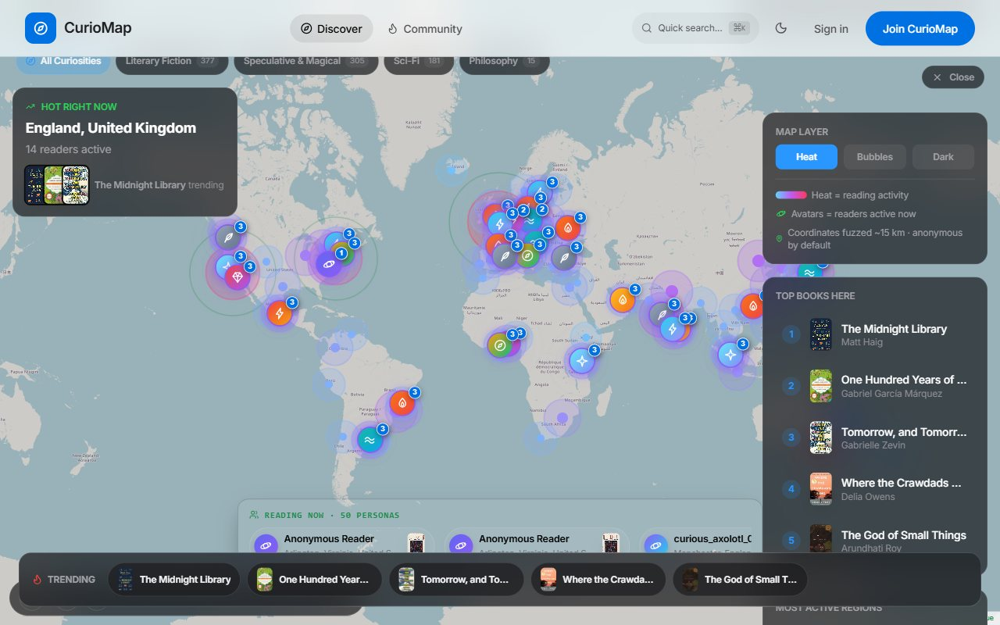
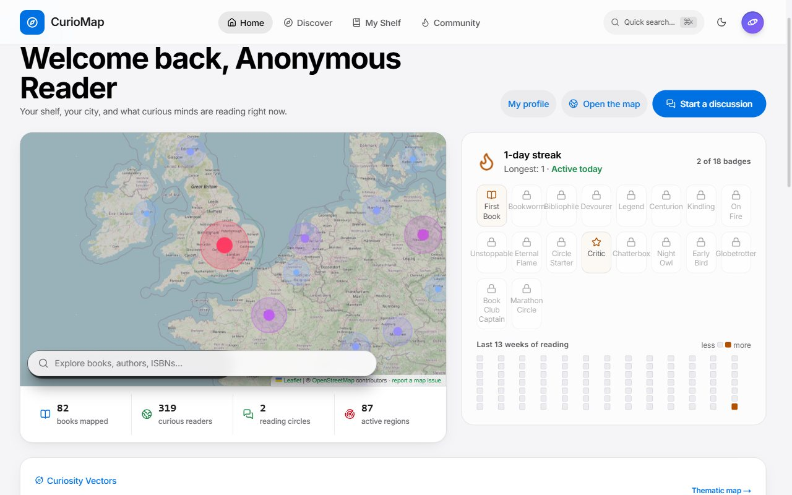
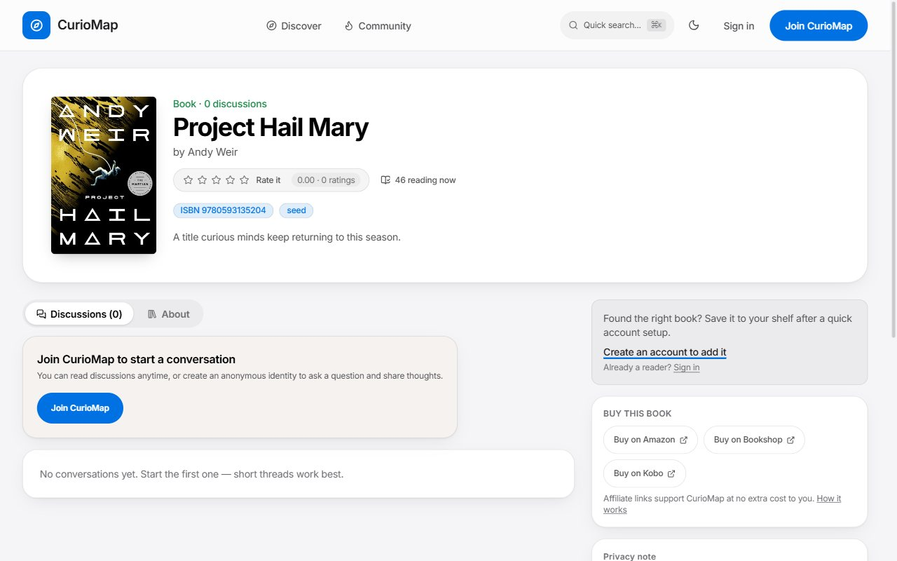
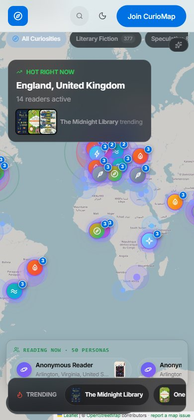
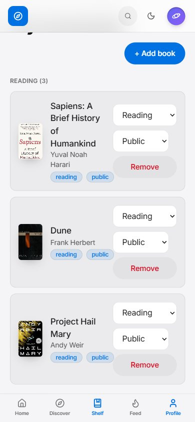
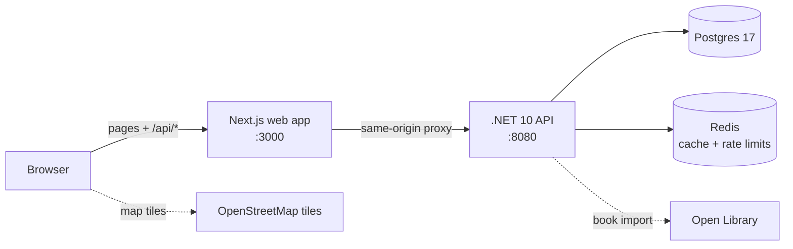

<div align="center">

# CurioMap

**A live map of human curiosity.**
An open-source, privacy-first place to find out what the world is reading, and talk about it.

[](https://github.com/curiomap/curiomap/actions/workflows/ci.yml)
[](https://github.com/curiomap/curiomap/actions/workflows/codeql.yml)
[](LICENSE)
[](https://dotnet.microsoft.com/)
[](https://nextjs.org/)
[](CONTRIBUTING.md)

[Quick start](#quick-start) · [Features](#features) · [Documentation](#documentation) · [Contributing](#contributing) · [Roadmap](docs/roadmap.md)



</div>

## What is CurioMap?

CurioMap connects readers through *what they are curious about right now*. Pick a book, see who
else is reading it around the world, and join a short, focused conversation about it, all under an
anonymous identity you control and a location that is deliberately blurred.

- **Anonymous by default.** A generated handle and a curated avatar. Real names are opt-in and reversible.
- **Location without surveillance.** We never store exact coordinates, only country/region/city and a
  point fuzzed to a ~15 km grid. You can narrow it to country-only or opt out of discovery entirely.
- **Small conversations.** Prompt-driven book threads and reading circles, not an endless feed.
- **Open and honest.** Apache 2.0, public roadmap, public design decisions, no tracking, no data selling.

## Features

| | |
|---|---|
| 🗺️ **Curiosity map** | A live global map and heat layer of what people are reading, filterable by theme (philosophy, sci-fi, ...) |
| 📍 **Readers near you** | City, region or country level matches, with full control over how precise you are |
| 📚 **Bookshelf** | Reading / finished / wishlist, ratings, public or private per entry |
| 💬 **Discussions** | Threads per book with prompts, reactions (insightful / funny / helpful), reporting and moderation |
| 👥 **Reading circles** | Small groups with chat, member limits and shared streaks |
| 🔥 **Streaks, badges and challenges** | Gentle motivation: reading streaks, 18 badges, a yearly reading goal |
| 🤝 **Follow and activity feed** | Follow readers you meet on the map and see what they shelve and say |
| 🛡️ **Privacy tools** | Display modes, location visibility, hidden shelf, and **self-service account deletion** |
| 🎨 **Polished UI** | Light and dark themes, keyboard quick search (`⌘K` / `Ctrl+K`), responsive down to phones |

<table>
  <tr>
    <td width="50%"></td>
    <td width="50%"></td>
  </tr>
  <tr>
    <td align="center"><sub>Your reading home: streak, badges, nearby readers</sub></td>
    <td align="center"><sub>A book: who is reading it and what they say</sub></td>
  </tr>
</table>

<p align="center">
  
  &nbsp;&nbsp;
  
</p>

## Quick start

You need **Docker**, the **.NET 10 SDK** and **Node.js 24** (20.9+ works). Details and alternatives are in the
[local development guide](docs/development.md).

```bash
git clone https://github.com/curiomap/curiomap.git
cd curiomap

cp .env.example .env            # Windows PowerShell: Copy-Item .env.example .env
(cd frontend && npm install)    # once
npm run dev                     # starts Postgres + Redis, the API and the web app
```

Open **<http://localhost:3000>**. The first start takes about a minute while the API builds, creates the
schema and seeds the catalog.

**No .NET or Node installed?** Run everything in containers instead:

```bash
docker compose --profile app up -d --build      # then open http://localhost:3000
```

| Service | URL |
|---|---|
| Web app | <http://localhost:3000> |
| API + reference docs | <http://localhost:8080> (`/docs`, `/health`) |
| Postgres / Redis | `localhost:5433` / `localhost:6380` |

To get a moderator account, register with `admin@curiomap.local` (the default in `.env.example`).
Something not working? See [Troubleshooting](docs/development.md#troubleshooting).

## How it fits together



| Layer | Technology |
|---|---|
| **API** | .NET 10, ASP.NET Core controllers, EF Core 10 + Npgsql, JWT with rotating refresh tokens |
| **Web** | Next.js 16 (App Router), React 19, TypeScript, Tailwind CSS 4, Leaflet |
| **Data** | PostgreSQL 17 (`pg_trgm` search), Redis 7; EF Core code-first migrations plus ordered SQL seeds |
| **Infra** | Docker, Fly.io, GitHub Actions (build, test, CodeQL, deploy) |

```
backend/     .NET API (CurioMap.Api) and its xUnit tests
frontend/    Next.js web app
docs/        architecture, data model, API, design system, privacy, ADRs, dev log
infra/       Dockerfiles and deployment notes
scripts/     dev orchestrator, route audit, map probes, seed generator
```

## Documentation

| Read this | To |
|---|---|
| [Local development guide](docs/development.md) | set up, configure, run the checks, debug |
| [Contributing](CONTRIBUTING.md) | find a task, open a good pull request |
| [Architecture](docs/architecture.md) and [ADRs](docs/adr/) | understand how and why it is built this way |
| [API reference](docs/api.md) | endpoints (interactive docs at `/docs` when running locally) |
| [Data model](docs/data-model.md) | tables and relationships |
| [Design system](docs/design-system.md) | build UI that fits |
| [Deployment](docs/deployment.md) | run your own instance (Fly.io, Neon, Upstash) |
| [Privacy policy](docs/privacy-policy.md), [Terms](docs/terms-of-use.md), [Affiliate policy](docs/affiliate-ads-policy.md) | what we promise readers |
| [Roadmap](docs/roadmap.md), [Vision](docs/vision.md) | where this is going |
| [Governance](GOVERNANCE.md) and [Maintainer guide](docs/maintainers.md) | how decisions get made |

## Privacy, in one paragraph

Accounts are anonymous by default. CurioMap stores **no exact coordinates**: location is country, region and
city, plus a coordinate fuzzed to a ~15 km grid. Display mode (anonymous, pseudonymous, real name) is
reversible; you can hide your bookshelf, limit sharing to country-only, or opt out of discovery. Public
profiles never expose email or precise location, and you can delete your account yourself from Settings.
Details: [docs/privacy-policy.md](docs/privacy-policy.md).

## Contributing

Contributions of every size are welcome: a typo fix, a new avatar, a conversation prompt, a bug fix, a whole
feature. Start with **[CONTRIBUTING.md](CONTRIBUTING.md)**, then look for issues labelled
[`good first issue`](https://github.com/curiomap/curiomap/labels/good%20first%20issue) or
[`help wanted`](https://github.com/curiomap/curiomap/labels/help%20wanted). Not sure where to begin? Ask in
[Discussions](https://github.com/curiomap/curiomap/discussions).

Everyone taking part is expected to follow the [Code of Conduct](CODE_OF_CONDUCT.md). Found a security
problem? Please follow [SECURITY.md](SECURITY.md) and report it privately.

## Support

Questions and ideas belong in [Discussions](https://github.com/curiomap/curiomap/discussions); reproducible bugs
in [Issues](https://github.com/curiomap/curiomap/issues). See [SUPPORT.md](SUPPORT.md).

## Credits and data sources

- Book metadata and covers come from [Open Library](https://openlibrary.org/) (Internet Archive).
- Map tiles and data © [OpenStreetMap contributors](https://www.openstreetmap.org/copyright), rendered with
  [Leaflet](https://leafletjs.com/). Please read the
  [tile usage policy](https://operations.osmfoundation.org/policies/tiles/) before serving real traffic.
- Buy links are affiliate links and are always labelled; see the [affiliate policy](docs/affiliate-ads-policy.md).

## License

[Apache License 2.0](LICENSE). Copyright © CurioMap contributors. See [NOTICE](NOTICE).
